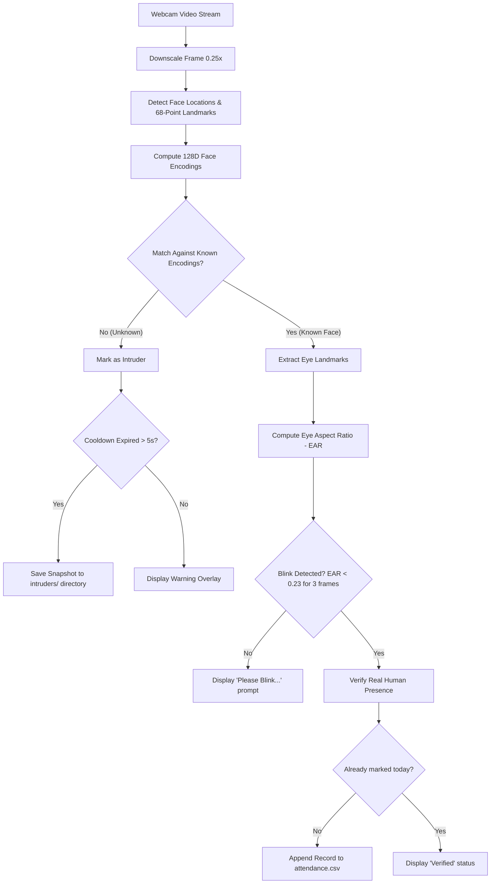

# 🎯 Smart Face Attendance System with Anti-Spoofing Liveness Detection

An automated, real-time facial recognition attendance system built using **OpenCV**, **Dlib**, and **face_recognition**. The system includes **blink-based liveness verification (Eye Aspect Ratio)** to eliminate photo spoofing attacks, automated **intruder snapshot logging**, and persistent **CSV attendance tracking**.

---

## 🌟 Key Features

- **🔍 High-Accuracy Face Recognition**: Employs deep metric learning with 128-dimensional facial embeddings for precise identity matching.
- **👁️ Anti-Spoofing Liveness Check**: Uses facial landmark tracking to compute the **Eye Aspect Ratio (EAR)**, requiring users to naturally blink before marking attendance.
- **🚨 Intruder Detection & Snapshot Capture**: Automatically flags unrecognized individuals and records timestamped snapshot images to an `intruders/` folder with configurable cooldown protection.
- **⚡ Optimized Real-Time Pipeline**: Scales video frames down to 25% for fast neural network inference while rendering overlays on full-resolution video.
- **📝 Automated Attendance Logging**: Appends daily attendance logs (`Name`, `Date`, `Time`) directly to `attendance.csv`, automatically preventing duplicate entries within the same day.

---

## 🏗️ System Workflow



---

## 📁 Repository Structure

```text
face_attendance/
├── known_faces/            # Place authorized personnel photos here (e.g., Sravan.jpg)
│   └── .gitkeep            # Directory tracking for git
├── intruders/              # Auto-saved snapshots of unrecognized faces
│   └── .gitkeep            # Directory tracking for git
├── mark_attendance.py      # Core real-time attendance & liveness engine
├── save_encodings.py       # Pre-computes 128D facial embeddings from known_faces/
├── requirements.txt        # Python package dependencies
├── .gitignore              # Ignores personal photos, encodings, and virtual environments
└── README.md               # Complete project documentation
```

---

## ⚙️ Prerequisites & Setup

### 1. Clone the Repository
```bash
git clone https://github.com/<your-username>/<your-repo-name>.git
cd face_attendance
```

### 2. Create and Activate a Virtual Environment

**Windows (PowerShell):**
```powershell
python -m venv venv
.\venv\Scripts\Activate.ps1
```

**Linux / macOS:**
```bash
python3 -m venv venv
source venv/bin/activate
```

### 3. Install Dependencies

> [!NOTE]
> On Windows, building `dlib` requires **CMake** and **Visual Studio C++ Build Tools**. Ensure `cmake` is installed before installing packages.

```bash
pip install --upgrade pip
pip install -r requirements.txt
```

*If you encounter issues installing `dlib` on Windows, install `cmake` first:*
```bash
pip install cmake
pip install dlib
pip install -r requirements.txt
```

---

## 🚀 How to Run

### Step 1: Register Known Faces
1. Take clear, well-lit portrait photos of authorized individuals.
2. Place the images into the `known_faces/` folder.
3. Name each image after the person (the file name becomes their attendance name):
   ```text
   known_faces/
   ├── Sravan.jpg
   ├── John_Doe.png
   └── Alice.jpeg
   ```

### Step 2: Generate Face Encodings
Run the encoding script to extract and serialize facial feature vectors into `encodings.pkl`:
```bash
python save_encodings.py
```
*Output:*
```text
✅ Encoded: Sravan.jpg
✅ Encoded: John_Doe.png
✅ Successfully encoded 2 face(s) to 'encodings.pkl'.
```

### Step 3: Launch Attendance System
Start the live attendance monitoring:
```bash
python mark_attendance.py
```

- Position your face in front of the camera.
- The interface will display `Please Blink...` in orange.
- Blink naturally: Once detected, your status will turn **Green (Verified)** and your record will be written to `attendance.csv`.
- Press **`q`** in the video window to quit.

---

## 📊 Sample Attendance Output (`attendance.csv`)

| Name | Date | Time |
| :--- | :--- | :--- |
| Sravan | 2026-10-14 | 09:15:32 |
| John_Doe | 2026-10-14 | 09:18:05 |

---

## 🔧 Configuration Parameters

All runtime thresholds can be customized in [mark_attendance.py](mark_attendance.py):

| Parameter | Default | Description |
| :--- | :--- | :--- |
| `TOLERANCE` | `0.6` | Maximum euclidean distance for face match. Lower is stricter. |
| `EYE_ASPECT_RATIO_THRESHOLD` | `0.23` | EAR value below which an eye is categorized as closed. |
| `EYE_ASPECT_RATIO_CONSEC_FRAMES`| `3` | Number of consecutive frames eyes must remain closed to confirm a blink. |
| `INTRUDER_COOLDOWN` | `5` | Minimum seconds between consecutive intruder photo captures. |

---

## 🛡️ Anti-Spoofing Technical Details

The **Eye Aspect Ratio (EAR)** calculation uses 6 Euclidean distances across 6 landmark points around each eye:

$$\text{EAR} = \frac{\|p_2 - p_6\| + \|p_3 - p_5\|}{2 \|p_1 - p_4\|}$$

- When eyes are wide open, EAR remains approximately between **0.28 and 0.35**.
- When eyes close during a blink, EAR rapidly drops below **0.23**.
- A static photograph or screen playback without natural blinks fails verification, preventing unauthorized access.

---

## 🛠️ Troubleshooting

- **`ModuleNotFoundError: No module named 'face_recognition'`**: Make sure you have activated the virtual environment where requirements were installed.
- **Camera Not Opening**: Verify webcam index in `mark_attendance.py` (`cv2.VideoCapture(0)`). Change `0` to `1` if using an external USB webcam.
- **False Unknown Rejections**: Ensure training photos in `known_faces/` have neutral lighting and face the camera directly without heavy shadows or occlusions.

---

## 📜 License
Distributed under the MIT License. Feel free to modify and adapt for personal or educational use.
